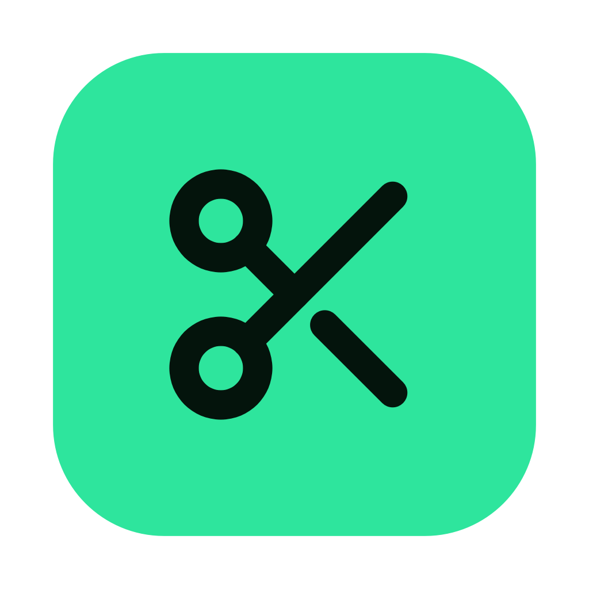
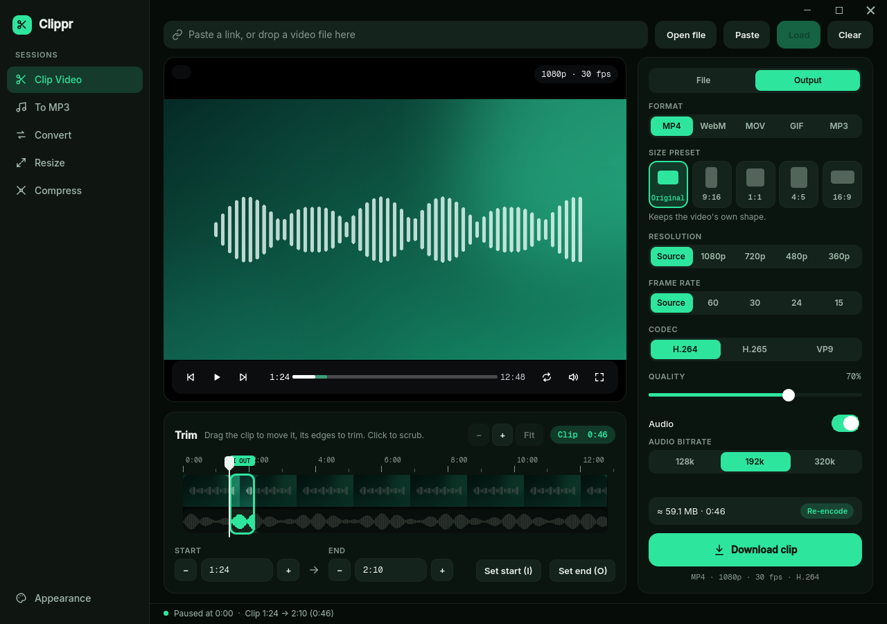
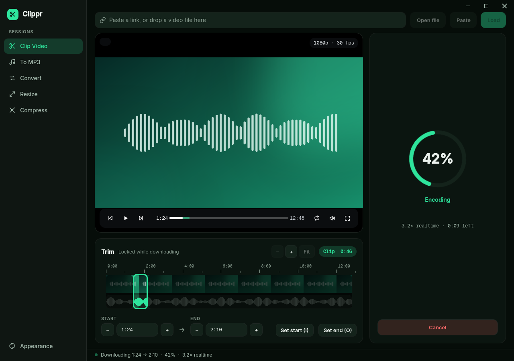
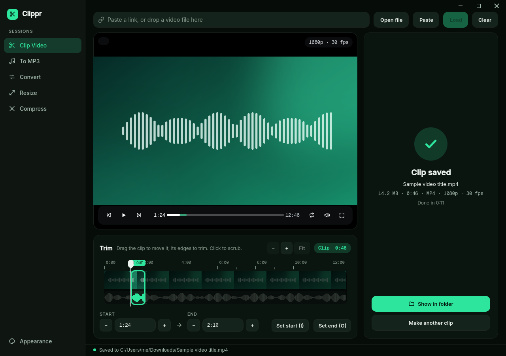
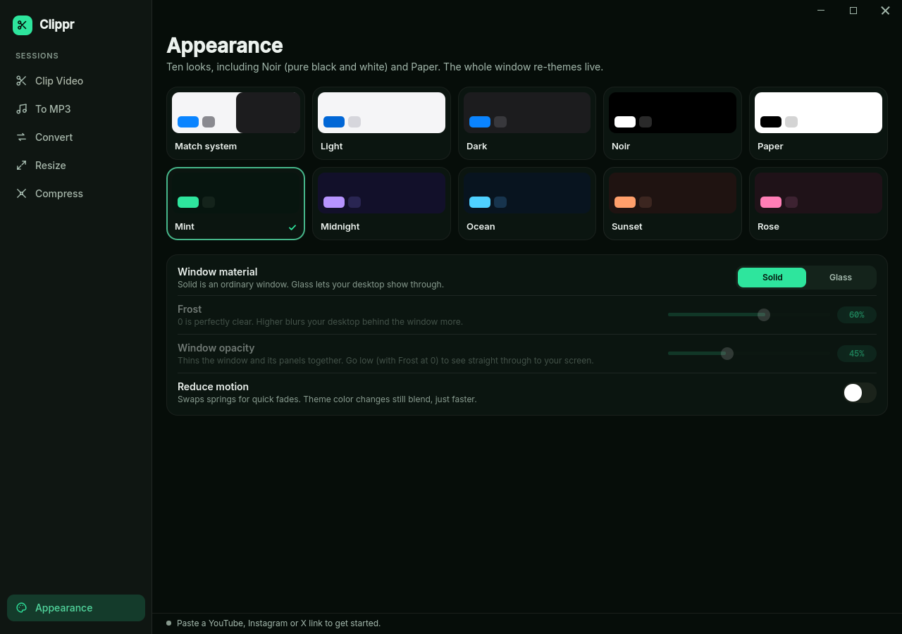
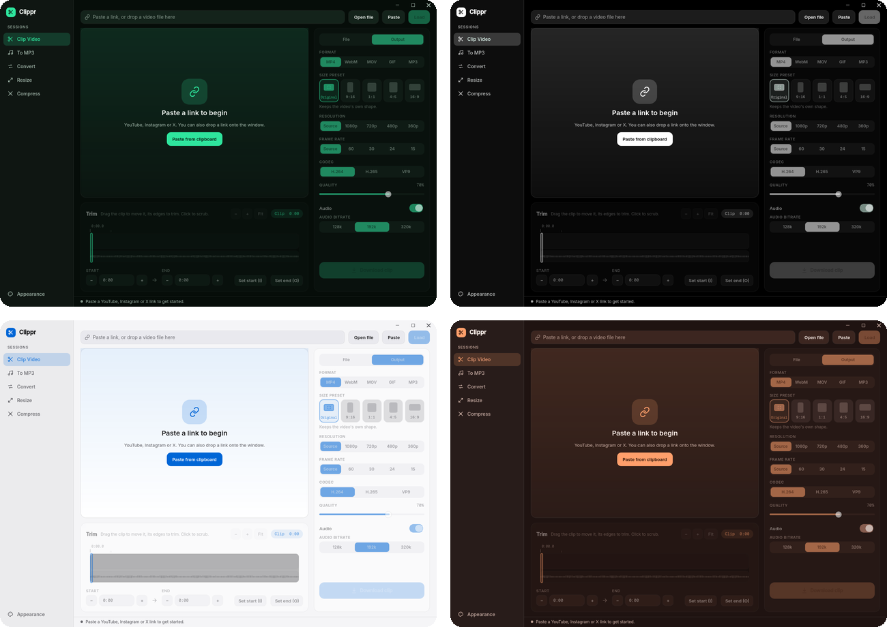

# Clippr

**Cut the exact part you want. Save it, convert it, shrink it.**

Paste a link or open a file, drag a clip on the timeline, and export it as video, GIF or audio.

-2fe5a0?style=flat-square)

## What it does

| Tool | What you get |
| --- | --- |
| **Clip Video** | Paste a YouTube, Instagram or X link, or open a file. Drag the clip on a timeline with a waveform (or press **I** / **O** to mark it) and export just that part as MP4, WebM, MOV, GIF or MP3. Pick a size preset (Original, 9:16, 1:1, 4:5, 16:9), resolution, frame rate, codec and quality. It tells you up front whether the export is a fast stream copy or a re-encode. |
| **To MP3** | Save audio as MP3, M4A, WAV, FLAC or Opus with cover art and tags. Paste many links at once. Optionally cut the leading silence so the file starts right at the song. |
| **Convert** | One converter for video, audio and pictures, including HEIC photos from an iPhone. |
| **Resize** | Batch resize, plus an editor to move, scale, rotate and crop a picture on its canvas. |
| **Compress** | Shrink PDFs, pictures, videos and audio, and see the size before and after. |

Everything takes drag and drop, runs a queue with live progress, and remembers its settings.

## Screenshots

<table>
  <tr>
    <td width="50%"></td>
    <td width="50%"></td>
  </tr>
  <tr>
    <td align="center">Live progress while it encodes</td>
    <td align="center">Done, with one click to the folder</td>
  </tr>
  <tr>
    <td width="50%"></td>
    <td width="50%"></td>
  </tr>
  <tr>
    <td align="center">Ten themes and a Glass window material</td>
    <td align="center">Mint, Noir, Light and Sunset</td>
  </tr>
</table>

## Install

**Windows installer.** Download `Clip-Downloader-Setup-<version>.exe` from the [Releases](../../releases) page and run it. It installs for your user account (no admin prompt), adds Start menu and Desktop shortcuts, and bundles ffmpeg.

**From source.**

1. Double-click `setup.bat` once. It creates a `.venv` and installs everything.
2. Double-click `Clip Downloader.bat` to start.

Or from a terminal: `.venv\Scripts\python run.py`

**Build the installer yourself.** Double-click `make_installer.bat` (or run `make_installer.bat /install` to build and install in one go). The first run sets up Python packages, downloads ffmpeg and installs Inno Setup for your user.

macOS: see [`docs/GUIDE.md`](docs/GUIDE.md#install-it-macos).

## Keyboard shortcuts

| Key | Action |
| --- | --- |
| `Ctrl+1` to `Ctrl+5` | Switch tool |
| `Space` | Play / pause |
| `I` / `O` | Set clip start / end |
| `Ctrl+Enter` | Download the clip |
| `Ctrl+Shift+O` | Open the save folder |

The full list, the resize editor controls and troubleshooting are in [`docs/GUIDE.md`](docs/GUIDE.md).

## Built with

[PySide6 / Qt Quick](https://doc.qt.io/qtforpython-6/) for the interface, [yt-dlp](https://github.com/yt-dlp/yt-dlp) for fetching media, [FFmpeg](https://ffmpeg.org/) for cutting and encoding, and the Inter and Geist fonts (SIL Open Font License).

## Please note

Only download or convert content you own or have permission to use, and follow each site's terms of service. If something stops working with a site, updating yt-dlp usually fixes it: `.venv\Scripts\python -m pip install -U yt-dlp`.

PDF compression uses PyMuPDF, which is AGPL-3.0. Check its license before distributing the app.
